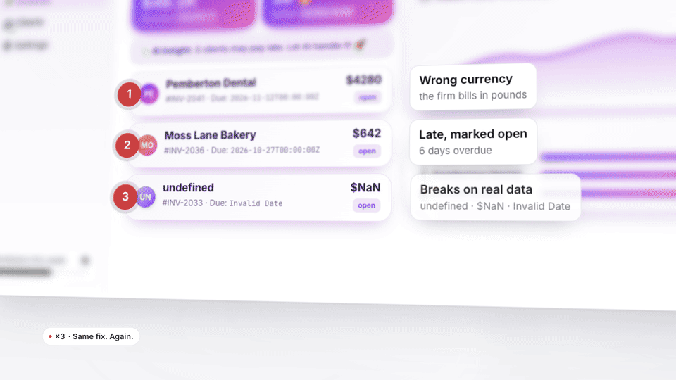

<p align="center">
  
</p>

<h1 align="center">Product Design Harness</h1>

<h3 align="center">A product design team for Claude Code.</h3>

<p align="center">
  One request takes a brief, or a Figma frame, to screens in code that were reviewed on the rendered page.<br />
  Six teammates, each with its own file, and gates that keep the steps in order.
</p>

<p align="center">
  <a href="#install"></a>
  <a href="CHANGELOG.md"></a>
  <a href="LICENSE"></a>
</p>

<p align="center">
  <a href="https://github.com/user-attachments/assets/f7b9cd7c-c9b5-438f-b000-6b70cd4ef3c9">▶ The film, 72 s</a> ·
  <a href="#install">Install</a> ·
  <a href="#the-team">The team</a> ·
  <a href="#a-run">A run</a> ·
  <a href="#gates">Gates</a> ·
  <a href="#what-lands-in-your-project">What lands in your project</a>
</p>

## Install

```text
/plugin marketplace add arez-xd/product-design-harness
/plugin install product-design-harness@arez-xd
```

The UI teammate and the design reviewer use [Design Taste](https://github.com/arez-xd/ux-ui-design-taste); the code reviewer uses [What Breaks in AI Code](https://github.com/arez-xd/what-breaks-in-ai-code). Both come from the same marketplace:

```text
/plugin install design-taste@arez-xd
/plugin install what-breaks-in-ai-code@arez-xd
```

To work from Figma, add the official Figma plugin:

```text
/plugin install figma@claude-plugins-official
```

## Quick start

```text
/product-design Design the invoices list for accountants who go through hundreds of invoices a day.
```

The lead says the plan in one line, with the models and roughly how long it takes, and starts. More requests are in [`examples/prompts.md`](examples/prompts.md).

## Why

One prompt gives a screen that looks finished. Then real data arrives: the empty state was never drawn, the error says "Something went wrong", the button is a new one the design system doesn't have, a list of 300 rows shows four, and the fix you gave on Monday has to be given again on Thursday.

The harness runs the work the way a product design team would. Success is agreed before the first screen. The decisions that shape the work come to you as options. Every state is designed and every string written before anything is built. The page is reviewed on the rendered page by a reviewer who never saw how it was built. And what you correct stays corrected: it becomes a rule every teammate reads in the next run.

## Who it's for

- **You build a product with Claude Code** and want its screens to hold up with real data, real states and the product's own components.
- **You're a designer** who wants the agent to work from your brief, your design system or your Figma file, and to bring the decisions to you.
- **You lead a team** and want a record: the brief, the numbered decisions with their reasons, the review with measurements, the hand-off with the debt that's left.

## The team

| Teammate | What it does | Writes |
|---|---|---|
| Lead (your session) | Plans the run, talks to you, keeps `design/` current | `run.json`, `rules.md`, `decisions.md` |
| Brief | The problem and its research, who uses it and how often, success criteria, principles, the design system, options for the decisions that shape the work | `brief.md`, `system.md` |
| Flows | Each task as a flow, the screens, every state of every screen | `flows.md` |
| Copy | The copy deck and the glossary | `copy.md` |
| UI | The foundations when there are none, then the screens in code, every state reachable in a preview | the screen files |
| Design review | The rendered page, blind to how it was built, with measurements | `review.md` |
| Code review | The code of the run, with What Breaks in AI Code | `review.md` |

## A run

1. **Frame.** The brief, the success criteria and the principles go to you for approval, with a walk through the data: what each field, each pair of fields that act on each other and each rule in the product's settings asks of the person on the screen.
2. **Explore.** Each decision that shapes the work comes to you as options with trade-offs and a recommendation. You decide; the reason is kept.
3. **Flows and states.** Every state of every screen, the ones the data implies included.
4. **Copy.** Every string and the glossary.
5. **Build.** From the product's system, every state reachable, and the action the screen exists for built up to the step the demo can't take.
6. **Review.** The design reviewer gets the preview and the spec, never the builder's notes: every state, copy against the glossary, values the design system doesn't have, accessibility checked by hand, the markers of generated-looking UI, prototype honesty, deceptive patterns. Two reviews at most: the second checks the first one's findings and the page as a whole, and what it leaves goes to the hand-over as debt or a decision. The code review runs once, and again only when it found a Blocker or a Major.
7. **Hand off.** What is final, the design-system changes, how each success criterion will be measured once the screens are in use, the UX debt and a usability test plan.

A new screen on the full path took 25 to 40 minutes in the test runs on Sonnet and cost 10 to 15 times a single prompt. A small change runs as `quick` and costs a fraction of that.

### Modes

| Request | What runs |
|---|---|
| `/product-design …` | The full path for a new screen, flow or feature |
| `/product-design quick …` | A small change to a screen that exists: the UI teammate builds it, both reviewers check what it touched, once |
| `/product-design frame` | Steps 1 and 2: the approved brief and the decisions |
| `/product-design build` | Steps 3 to 6, on an approved brief |
| `/product-design review` | Step 6 on screens that already exist |
| `/product-design feedback` | Crit notes or test findings turned into changes |
| `/product-design handoff` | Step 7 |
| `/product-design capture …` | A rule for the project, kept for every run after |
| `/design-review <url>` | A blind design review of any page, outside a run |

## Steering it

Say what you want at any point, in words: "quick", "only the brief", "build on Opus", "everything on Sonnet", "use Mobbin for references", "decide yourself and show me at the end". The lead writes it into `design/run.json` and the team follows it.

- **Sources.** MCP servers, references and constraints you name go into `design/sources.md`, which every teammate reads. A source added mid-run sends the steps it touches back through the team.
- **Rules.** Correct something and the lead sorts it: what holds on any screen of the product becomes a rule (offered the first time, kept the second), and a judgment about one screen becomes a numbered decision. Rules live in `design/rules.md`, hold over defaults, and the reviewers check them where they say how.
- **Decisions.** Every decision is numbered, with its reason, the options turned down and what was learned. A change that would undo one comes to you with its number.

## From a brief alone

With no screens and no design system in the project, the run starts further back. The Brief teammate researches the problem with the sources and tools at hand (web search, a reference library over MCP, the links you give), with a source and a date for every finding and assumptions marked for the test plan. Step 2 brings two or three visual directions, rendered on the same sample, and the UI teammate lays the foundations of the one you pick (tokens and core components) before any screen.

## Gates

Hooks hold the team to the process, so the lead can't skip a step to save time:

- **No screen before the brief, the states and the copy.** Writing a screen file is blocked until `design/brief.md` has success criteria you approved and `design/flows.md` and `design/copy.md` are filled.
- **The team does the work.** Only the UI teammate writes screen files (markup, styles and the scripts the page runs on); `flows.md` and `copy.md` belong to their teammates.
- **One step at a time.** A teammate starts once the steps it reads have returned: flows, then copy, then the build, then both reviews side by side, then the fixes.
- **Models by the plan.** No teammate runs above your session's model unless you asked for it.
- **No finish without the reviews.** While screens changed after the last design review, or after the last code review when its verdict wasn't ship, the lead is asked to run them before it finishes.

The gates stay quiet without `design/run.json`, while a run is paused, and once a finished run's reviews are fresh.

## Models

Every teammate runs on your session's model unless the plan says otherwise. On Opus or Fable, flows, copy and a code review of interface-only changes run on Sonnet, where the stronger model adds little; a code review that touches server code, data writes, money or permissions stays on your model. Any of it can be set per teammate in `design/run.json` under `models`. If `CLAUDE_CODE_SUBAGENT_MODEL` is set in your environment, it can override the plan; unset it for a run.

## What lands in your project

| File | Holds |
|---|---|
| `design/brief.md` | Problem, users, constraints, terms, success criteria, principles |
| `design/decisions.md` | Numbered decisions with reasons, options turned down and lessons; pushbacks; feedback |
| `design/system.md` | Tokens and components the screens are built from, and the gaps |
| `design/flows.md` | Tasks, screens and every state |
| `design/copy.md` | Glossary and strings |
| `design/review.md` | Verdict and findings, each with a measurement and a source |
| `design/handoff.md` | What is final, the design-system change record, how to measure the criteria, the UX debt |
| `design/test-plan.md` | Tasks, participants and findings by who failed which task |
| `design/rules.md` | The project's standing rules, kept between runs |
| `design/sources.md` | MCP servers, references and constraints to work from, kept between runs |
| `design/run.json` | Where the run is |
| `design/history/` | Finished runs' files, moved there when the next run starts |

`rules.md`, `sources.md`, `decisions.md` and `system.md` outlive a run; the rest belongs to one. After the first run the lead offers a pointer in your `CLAUDE.md`, so ordinary sessions follow the rules, decisions, design system and glossary too.

## Figma

The Brief teammate reads the frames you link through the Figma MCP server and caches what it reads in `design/figma/` for the rest of the team. Figma's Starter plan and View or Collab seats allow 6 MCP calls a month, so a run spends at most 4 unless you allow more.

## Requirements

- Claude Code with plugins, subagents and hooks.
- Node 18 or later for the gates.
- A way to render the project's screens: a dev server, a render command or a browser tool. A teammate that can't see the page can't review it.
- For Figma, the official Figma plugin and a Figma account with MCP access.

## Status

0.4.0, early. So far it has been tried only on fictional products its author built to test it. Those runs found defects that this version fixes; they can't show how it compares with working without it. What changed in each version is in the [changelog](CHANGELOG.md).

## Contributing

Issues and pull requests are welcome. The gates have tests: `npm test`. A change to a teammate's instructions is best sent with a run that shows what it fixed.

## License

MIT, see [LICENSE](LICENSE). The two companion plugins are MIT as well.
